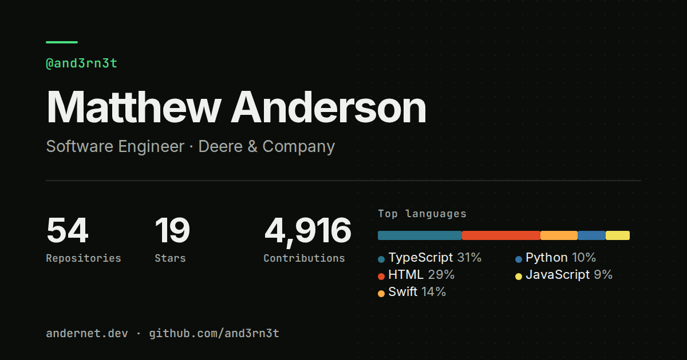

# Hi, I'm Matt 👋

[](https://github.com/and3rn3t/and3rn3t/actions/workflows/quality.yml)
[](https://github.com/and3rn3t/and3rn3t/actions/workflows/pages.yml)
[](https://github.com/and3rn3t/and3rn3t/actions/workflows/lighthouse.yml)
[](https://github.com/and3rn3t/and3rn3t/actions/workflows/codeql.yml)
[](LICENSE)

I'm Matthew Anderson (@and3rn3t), a software engineer at Deere & Company. On my own time I build health tech, home automation and a lot of small tools, mostly in TypeScript, Swift and Python.

**[andernet.dev](https://andernet.dev)** is my portfolio. Each project has its own write-up, there are a few posts on how things are built, and the GitHub activity on the page is live.

[](https://andernet.dev)

## What's in this repo

This repo is both my GitHub profile and the source of that site.

- **No framework.** Plain ES modules, served as-is by GitHub Pages. There's no build step.
- **A WebAssembly hero.** The particle background is written in AssemblyScript and compiled to WebAssembly.
- **A small Cloudflare Worker** handles the parts a static site can't: view counts, the guestbook and the recent-activity feed.
- **Pre-rendered pages.** The project and post pages are generated from JSON files, so they read fine without JavaScript.
- **Light and dark themes** that follow your system, and it works offline as a PWA.
- **Readable by machines too.** There's an [llms.txt](https://andernet.dev/llms.txt), and every page comes back as Markdown if you ask for it with `Accept: text/markdown`.

## Run it locally

You'll need Node 24.15 or newer (`.nvmrc` pins the exact version) and [pnpm](https://pnpm.io) 11.8 or newer. The repo enforces both with `engine-strict`, so an older Node makes `pnpm install` fail.

```sh
pnpm install
pnpm dev          # local dev server at http://localhost:3000
pnpm validate     # lint, formatting, unit tests and link checks
pnpm test         # unit tests plus the browser tests
pnpm worker:dev   # run the Cloudflare Worker locally
```

If you change a project, post or job, edit the JSON data files and run `pnpm generate:site`. The pages are generated, so don't edit the HTML by hand. [AGENTS.md](AGENTS.md) has the full set of conventions and [ROADMAP.md](ROADMAP.md) has what's planned.

## Featured projects

A workflow refreshes this list from my repos every day. The full write-ups are on the [portfolio](https://andernet.dev/#projects).

<!-- FEATURED-PROJECTS:START -->

### 🌐 [fastlane](https://github.com/and3rn3t/fastlane)

> A recreation of the 90s SIERRA game "Jones in the Fast Lane" - modernized.
>
> **Tech:** TypeScript

### 🌐 [guess](https://github.com/and3rn3t/guess)

> Andernator: an Akinator-style guessing game that shows its Bayesian reasoning. React + Cloudflare Pages/D1, 53K+ characters, Expo mobile app.
>
> **Tech:** TypeScript, akinator, bayesian, cloudflare-d1, cloudflare-pages
> 🔗 [Live](https://andernator.com)

### 🌐 [homehub](https://github.com/and3rn3t/homehub)

> iOS-inspired smart home dashboard — device control, scenes, automations, live Arlo camera streaming. React 19 PWA on Cloudflare Pages + Workers.
>
> **Tech:** TypeScript, arlo, cloudflare-pages, cloudflare-workers, dashboard
> 🔗 [Live](https://homehub.andernet.dev)

### 🐍 [minecraft](https://github.com/and3rn3t/minecraft)

> Self-hosted Minecraft server manager for Raspberry Pi 5 (ARM64) — Docker deployment, automated backups, plugin/mod management, multi-world support, RCON, a Flask REST API, and a React admin panel.
>
> **Tech:** Python, arm64, docker, docker-compose, flask

### 🌐 [health](https://github.com/and3rn3t/health)

> VitalSense — Apple Health insights, fall risk detection, emergency alerts, and caregiver dashboards. React + Cloudflare Workers + native iOS (HealthKit).
>
> **Tech:** TypeScript, ai, caregiver, cloudflare-workers, fall-detection
> 🔗 [Live](https://health.andernet.dev)

### 🖥️ [net-traffic](https://github.com/and3rn3t/net-traffic)

> Unifying network information on a RPi 5
>
> **Tech:** HTML, cloudflare-workers, networking, raspberry-pi, react

### 🐍 [apple-music-dj](https://github.com/and3rn3t/apple-music-dj)

> AI Apple Music curator: playlists from your real listening history. Agent Skill for Claude Code and OpenClaw. Try the demo with no account.
>
> **Tech:** Python, agent-skill, agent-skills, ai-dj, apple-music
> 🔗 [Live](https://clawhub.ai/and3rn3t/skills/apple-music-dj)

<!-- FEATURED-PROJECTS:END -->

## Get in touch

- Email: [and3rn3t@icloud.com](mailto:and3rn3t@icloud.com)
- LinkedIn: [linkedin.com/in/and3rn3t](https://linkedin.com/in/and3rn3t)
- GitHub: you're already here

The code is [MIT licensed](LICENSE). See [CONTRIBUTING.md](CONTRIBUTING.md) if you want to suggest a change, and [SECURITY.md](SECURITY.md) to report a vulnerability.

<div align="center">


</div>
